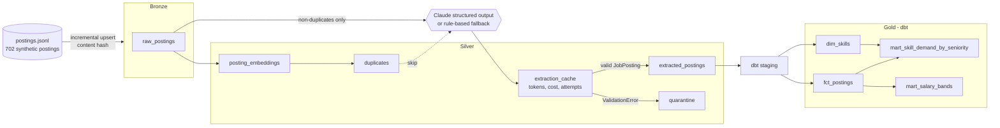

# llm-etl

An ELT pipeline that turns unstructured job postings into a tested, modeled warehouse.
Raw text lands in **bronze**. Claude extracts each posting into a strict Pydantic schema, which becomes **silver**.
**dbt** then builds the **gold** marts: skill demand by seniority and salary bands. Airflow orchestrates the steps.
DuckDB runs it locally, and the same dbt project targets Snowflake.

No API key? Everything still runs. When `ANTHROPIC_API_KEY` is unset, a deterministic rule-based
extractor takes over, so `make test` and `make run` work offline (and in CI).



## Quickstart

Requires [uv](https://docs.astral.sh/uv/). uv installs Python 3.12 if needed.

```bash
make install          # uv sync --all-groups  (runtime + dev + airflow)
make test             # ruff + 48 pytest tests, including the DAG import and a full `dbt build`
make run              # ingest -> dedup -> extract -> dbt build -> eval  (writes reports/metrics.json)

# with Claude (after one offline run, so eval can compare both extractors side by side)
cp .env.example .env  # set ANTHROPIC_API_KEY, then: set -a; source .env; set +a
make run
```

Individual steps: `uv run llm-etl {generate|ingest|dedup|extract|dbt|eval}`. The warehouse is
`warehouse/llm_etl.duckdb`. To inspect it, run `duckdb warehouse/llm_etl.duckdb "from gold.mart_salary_bands"`.

## How it works

| Step | Code | What it does |
|---|---|---|
| Generate | `generate.py` | Builds a deterministic synthetic feed (seed 42) with ground truth. It has 630 valid postings, 60 reposts and 12 invalid records (spam, truncated text, inverted salary ranges). The data is committed, and a test proves it regenerates byte for byte. |
| Ingest | `warehouse.py` | Upserts the feed into `bronze.raw_postings`. Only new or changed postings are written, keyed by `sha256(text)`. |
| Dedup | `dedup.py` | Embeds each new text once (hashed char 3-5-gram vectors, 512-d). A posting whose cosine similarity to an *earlier* posting is at or above 0.86 is flagged as a repost of that posting's original. |
| Extract | `extract.py`, `extract_llm.py`, `extract_rules.py` | Each non-duplicate text goes to Claude (`claude-haiku-5-5` by default, via `ANTHROPIC_MODEL`) with SDK structured output. The result must then pass `schema.JobPosting`. On failure, the validation errors are sent back to the model and it retries, up to 3 attempts in total. Results are cached per `(content_hash, extractor version)`. |
| Silver | `extract.materialize_silver` | Rebuilds `silver.extracted_postings` and `silver.quarantine` from the cache, in one transaction. |
| Gold | `dbt/` | Staging views, then `fct_postings` (with salaries normalized to USD through an FX seed), `dim_skills`, `mart_skill_demand_by_seniority` and `mart_salary_bands`. |
| Eval | `evaluate.py` | Field-level accuracy on the golden set, plus dedup and quarantine scores against ground truth. Writes `reports/metrics.json`. |
| Orchestrate | `dags/llm_etl_dag.py` | Airflow 3 TaskFlow DAG with the same five steps. Each task calls the same `pipeline.step_*` function as the CLI. |

### Data quality

- **Contract.** `JobPosting` uses `extra="forbid"`, and seniority, remote policy, currency and skills are restricted to fixed values.
  Salary must be all-or-nothing, with min ≤ max, and must fall inside annual bounds of 10k to 1M. That last rule catches an hourly rate
  mis-read as a salary. The skill vocabulary is defined once, in `dbt/seeds/skill_taxonomy.csv`. Python validation and the dbt
  `relationships` test both read it.
- **Quarantine.** A record that fails validation is never dropped. It lands in `silver.quarantine` with the reason.
- **dbt tests (48).** These are `unique`, `not_null`, `accepted_values` and `relationships` tests on sources, staging and marts,
  plus 4 singular tests:
  - `assert_bronze_fully_accounted_for`: every bronze row lands in exactly one of silver, quarantine or duplicates.
  - `assert_salary_range_consistent`
  - `assert_no_duplicates_in_gold`
  - `assert_skill_share_in_unit_interval`

## Measured results

All numbers come from `make run` on the bundled dataset (`reports/metrics.json`), on an M-series Mac.
They were measured with the **offline extractor only**. No API key was available while this was built,
so **LLM extraction accuracy, token usage and cost have not been measured yet**. Run with a key to fill
in the `rules` vs `llm` comparison. The per-record token and cost log is in `silver.extraction_cache`.

**Extraction: rule-based extractor on the 50-record golden set** (labels taken from generator ground truth)

The golden set has two slices:
- **standard** (35 records) uses the phrasings the rules were written against.
- **long-tail** (15 records) uses phrasings that were added *after* the rules were frozen and never taught to them: "between 90 and 110 thousand euros a year", "split your week between home and the office", "Kube", "foundation models" and similar. This slice simulates phrasing drift in a real feed.

| Field | Standard (35) | Long-tail (15) | Overall (50) |
|---|---|---|---|
| title | 1.00 | 0.00 | 0.70 |
| seniority | 1.00 | 0.40 | 0.82 |
| salary min / max / currency | 1.00 | 0.20 | 0.76 |
| remote_policy | 1.00 | 0.40 | 0.82 |
| location | 1.00 | 0.20 | 0.76 |
| skills precision / recall | 1.00 / 1.00 | 1.00 / 0.30 | 1.00 / 0.79 |
| records passing validation | 35 / 35 | 6 / 15 | 41 / 50 |

The 1.00 scores on the standard slice are **not** a claim about real-world text. The rules and the
generator were written together, so that slice is an upper bound. The long-tail slice is the honest
signal: regex rules collapse on phrasing they have not seen. That gap is the reason the LLM path
exists. Across the full feed, the rules quarantined **57 of the 120 valid long-tail postings** because none
of their remote-policy rules matched. The quarantine table makes that failure visible instead of letting it
silently skew the marts.

**Semantic dedup** (60 reposts in ground truth, threshold 0.86)

| | Value |
|---|---|
| Reposts caught | 60 / 60 (recall 1.00), each mapped to the correct original |
| False positives | 0 (precision 1.00) |
| Separation margin | least-similar true repost 0.919 vs most-similar non-duplicate 0.798 |
| Threshold sweep | precision 1.00 from 0.80 to 0.95. Recall falls to 0.98 at 0.92 and to 0.92 at 0.95 |

The non-duplicates include 30 hard negatives: postings with the same company and title but a different city, stack and salary.
The threshold sits between the two similarity distributions. These reposts are surface edits, which char n-grams
catch well. Paraphrased reposts would need a semantic embedding model; see the design notes.

**Quarantine:** all 12 of 12 invalid records were quarantined (5 spam, 3 truncated, 4 inverted salary ranges).

**Incremental behaviour:** a second `make run` makes **0** extraction calls, because every text is served from the cache.
Changing one posting's text re-extracts exactly **1** record. Both behaviours are asserted in `tests/test_pipeline.py`.
Running dedup *before* extraction means the 60 reposts (8.5% of the feed) never reach the LLM.

**Runtime:** the full offline `make run` (702 postings, extraction, 56 dbt nodes, eval) takes about 10 seconds.

## Design decisions

- **Validate twice, at the right layer.** Claude's structured output (`messages.parse(output_format=LLMOutput)`)
  guarantees well-typed JSON, but not business rules. `JobPosting` enforces those rules. Its errors are sent back to
  the model as a correction prompt, so a retry has something specific to fix.
- **Cache key = content hash + extractor version** (`llm:<model>:v1`, `rules:v1`). Re-runs are free.
  Changing the prompt or model invalidates exactly what it should. Cached rows double as the cost log.
- **Transient failures are never cached.** Rate limits and outages get the SDK's exponential backoff (`max_retries=6`,
  which honors `retry-after`). If a call still fails, the rest of the batch is saved and the step raises. The next run
  or Airflow retry resumes with only the missing records. Validation failures *are* cached, because retrying the same
  text with the same prompt wastes money. Bump `PROMPT_VERSION` to retry them deliberately.
- **Batched, bounded concurrency.** Records go out in batches of `LLM_BATCH_SIZE`, using `LLM_CONCURRENCY` threads, and each batch
  is committed. A crash loses at most one batch. The Message Batches API would be about 50% cheaper but asynchronous (hours).
  It is a good swap for a nightly backfill.
- **Silver is rebuilt from the cache.** `materialize_silver` is idempotent, so there is no partial-update bookkeeping.
  The reconciliation test proves no row is lost or double-counted.
- **Local, deterministic embeddings.** Hashed n-gram vectors need no model download and are bit-for-bit reproducible
  in CI. They suit reposts, which are near-verbatim. The dense O(n²) similarity is fine up to about 20k rows. Beyond that, use
  an ANN index (DuckDB `vss`, FAISS) or a sentence-transformer for paraphrase-level matching.
- **Portable dbt.** The only adapter-specific SQL is the array unnest. `macros/unnest_skills.sql` dispatches it to DuckDB
  `unnest()` or Snowflake `lateral flatten`. Percentiles use `percentile_cont ... within group`, which both engines support.
- **DuckDB is single-writer**, so the DAG runs one task at a time (`max_active_tasks=1`). On Snowflake that limit can be lifted.

## Running against Snowflake

`dbt/profiles.snowflake.example.yml` is a key-pair-auth profile for the same project. Load the bronze and silver tables into
Snowflake (for example Parquet through a stage and `COPY INTO`, with `skills` as an `ARRAY`), then run
`dbt build --target snowflake --profiles-dir <dir-with-that-profile>`. No model changes are needed.
*Not exercised here: no Snowflake account was available, so treat this path as a documented template, not a tested one.*

## Limitations

- The data is synthetic. Real postings are messier, and the generator's templates are far more regular than a real job board.
- Golden labels are derived from generator ground truth, not from independent human annotation.
- LLM accuracy and cost are unmeasured until someone runs the pipeline with an API key (see above).
- The FX rates in `dbt/seeds/fx_rates.csv` are a fixed snapshot used to compare markets, not live rates.

## Layout

```
src/llm_etl/    schema, generate, warehouse, dedup, extract{,_llm,_rules}, evaluate, pipeline (CLI)
dags/           Airflow DAG
dbt/            models/{staging,marts}, seeds, macros, singular tests, profiles (duckdb + snowflake template)
data/           raw feed + ground truth, golden labels
tests/          pytest suite
reports/        metrics.json from the last eval
```

MIT licensed.
